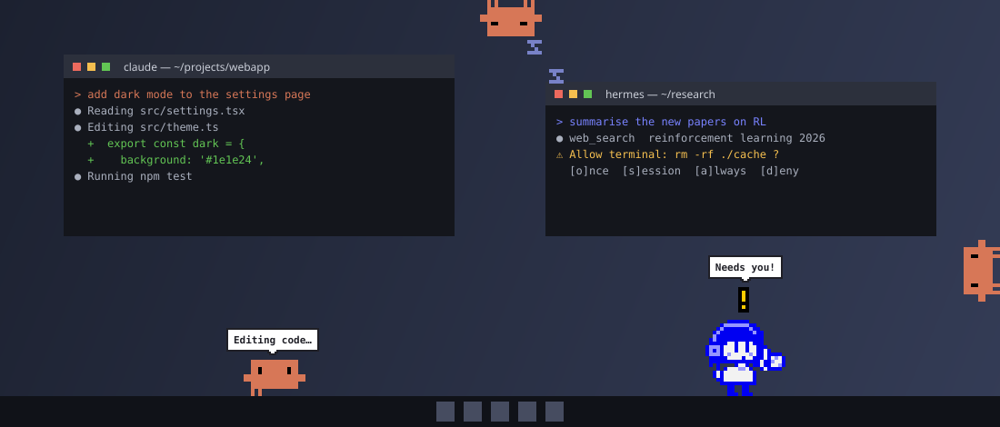
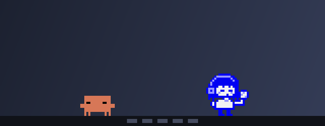
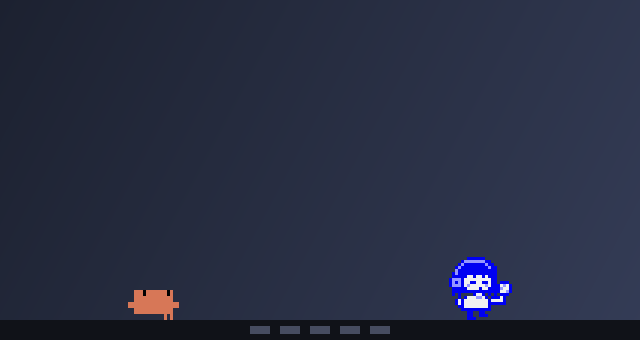
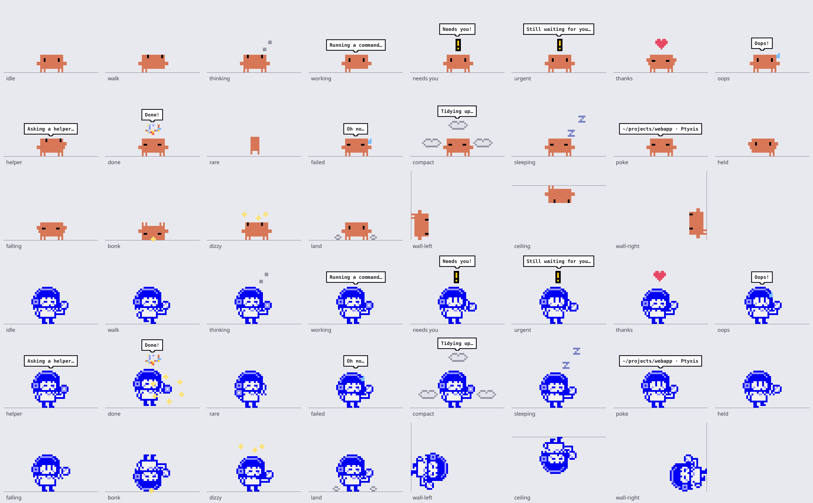

# AgentPet

Pixel-art desktop pets for your coding agents. Each pet belongs to one agent window and shows you
what that agent is doing: thinking, running a command, editing code, waiting for your approval,
done. Between turns they wander along the bottom of your screen, climb up its sides and hang
upside down from the top.

> **For now AgentPet works with two agents only:**
> **[Claude Code](https://docs.anthropic.com/en/docs/claude-code)**, whose pet is **Clawd**, its crab,
> and **[Hermes Agent](https://github.com/NousResearch/hermes-agent)**, whose pet is **Hermes**, the girl
> with the orb from the Nous portal. Other agents may follow.

Runs on **Linux, macOS and Windows**.

## The pets

The two pets are independent. Clawd only ever shows what its Claude Code session is doing, and
Hermes only what its Hermes is doing. Each one is on screen only while its agent runs, and there is
one pet per agent window: three Claude Code sessions open means three Clawds (up to 8 pets in all).

| | when | Clawd | Hermes |
|---|---|---|---|
| Thinking | you send a prompt | eyes up, thought dots | orb pulses, thought dots |
| Working | a tool runs | types away; the bubble says what ("Running a command…") | orb spins; same bubble |
| Needs you | waiting for your approval | waves with a "!", louder after 30 s | waves with a "!" |
| Thanks | right after you approve | arms up, a heart | a bow, a heart |
| Oops | a tool failed | shakes, sweats | surprised, sweats |
| Helper | a subagent starts during a turn | "Asking a helper…" | "Asking a helper…" |
| Done | the turn finished | cheers, confetti | sparkles from the orb, confetti |
| Oh no | the turn failed | "Oh no…" | droops, "Oh no…" |
| Tidying up | the conversation is compacted | poof | poof |
| Surprise | 3 % of finished turns | a full turn, drawn from Claude Code's own turn-around sprites | the orb circles her |

After ten quiet minutes a pet falls asleep wherever it is. When its agent exits (however it
exits: `/exit`, Ctrl-C, a crash), the pet leaves within seconds.

**Getting around.** A pet likes the floor, but when idle it sometimes scurries to the side of the
screen, climbs the wall and may carry on upside down along the top. From there it climbs back
down, or lets go: a fall from up there lands it on its head, dizzy, stars circling. When its agent
needs it, a pet up a wall or on the ceiling hops straight down (onto its feet) and reacts on the
floor.

**The mouse.** Drag a pet to pick it up (it dangles), and let go anywhere: near a side it grabs
the wall, near the top it hangs from it, in mid-air it falls (from high up, onto its head). Click a
pet and it tells you which window it belongs to: its agent's folder and terminal, such as
`~/projects/webapp · Windows Terminal`, plus the tab when two agents share both. If it needs you,
it says so: `Needs you: ~/projects/webapp · iTerm2`.

Every pose, on the floor, on the walls and on the ceiling:

## Install

You need Python 3.10 or newer and [uv](https://docs.astral.sh/uv/) (or
[pipx](https://pipx.pypa.io/)).

    uv tool install git+https://github.com/jstjep00/AgentPet
    agentpet connect          # hooks Clawd into Claude Code and Hermes into Hermes (each one you have)
    agentpet demo             # every reaction once, for both pets

That is all: from now on the pets come out by themselves when you start an agent. Sessions that
were already running pick the hooks up after a restart (or `/hooks` in Claude Code).

With pipx instead: `pipx install git+https://github.com/jstjep00/AgentPet`.

**Linux.** Any X11 desktop, or a Wayland desktop with XWayland (GNOME, KDE Plasma, sway, Hyprland
and others run it by default); the pets use X11 so that they can stay on top and be placed. On
Debian and Ubuntu, Qt needs `sudo apt install libxcb-cursor0` if it is not there already.

**macOS.** The pets have no Dock icon, and show on every Space and over full-screen apps.

**Windows.** Windows 10 or 11, with Claude Code installed natively. If you run Claude Code inside
WSL, install AgentPet inside WSL too (the pets then show through WSLg).

## Commands

    agentpet run | quit                  start / stop the pets (the hooks start them on their own)
    agentpet connect [claude|hermes|all]
    agentpet disconnect [claude|hermes|all]
    agentpet status
    agentpet demo [claude|hermes|all]    every reaction once
    agentpet demo climb                  both pets up the wall, over the top, and down with a bonk
    agentpet demo many                   five agent windows at once, five pets
    agentpet size small|normal|large|huge
    agentpet sheet FILE.png              every pose of both pets in one picture

## How it works

* **Claude Code**: `connect` adds one command hook per event to `~/.claude/settings.json`
  (`"…/agentpet" hook claude`). The file is backed up first
  (`settings.json.agentpet-backup-<time>`), all your other hooks are kept, and `disconnect` removes
  only these. The hook prints nothing and always exits 0, so it never gets in Claude Code's way.
* **Hermes**: `connect` writes a plugin to `~/.hermes/plugins/agentpet` and runs
  `hermes plugins enable agentpet`. Its hooks return nothing, so Hermes behaves as before.
* Each event becomes one small message to the pets over a private local channel (a Unix socket
  only you can open, or a named pipe on Windows): which agent, the event name, a session id, the
  tool name, the folder, the terminal's name and the agent's process id. **No prompts, code,
  commands or output, and nothing goes over the network. There is no telemetry.**
* A pet is tied to its agent's process: it stays while that process runs and leaves when it exits.
* The pets are small, see-through, always-on-top windows drawn with Qt. Clicks pass through
  everywhere except on a pet.

## Status

AgentPet was built and is used daily on Linux (Ubuntu, GNOME on Wayland). On macOS and Windows,
every test runs in CI, including the real pet app headless, taking hook messages over the real
channel and drawing pets, but it has not been tried on real macOS and Windows desktops yet. If
something looks off there, please [open an issue](https://github.com/jstjep00/AgentPet/issues).

Known limits:

* No desktop lets one app switch you to another's window, or read its title, so a click on a pet
  tells you which folder and terminal its agent is in instead of switching to it.
* The pets live on the primary screen.

## Uninstall

    agentpet disconnect
    agentpet quit
    uv tool uninstall agentpet          # or: pipx uninstall agentpet

## Development

    uv venv && uv pip install -e . pillow
    QT_QPA_PLATFORM=offscreen .venv/bin/python -m unittest discover -s tests -t .
    .venv/bin/python tools/readme_images.py      # redraws the pictures in docs/

## Credits

AgentPet is a fan project. It is not made by, affiliated with or endorsed by Anthropic or Nous
Research.

* **Clawd** is Claude Code's mascot, by Anthropic. Its sprite here reproduces the one Claude Code
  draws in the terminal (`agentpet/sprites.py`).
* **Hermes** is drawn after the Hermes Agent portal art by Nous Research, who own that art and
  the Hermes name.
* The see-through always-on-top X11 windows and the mapping of Hermes's plugin hooks onto agent
  events follow [ThatPet](https://thatpet.app) (MIT).

The code is MIT licensed (see [LICENSE](LICENSE)); the characters belong to their owners.
